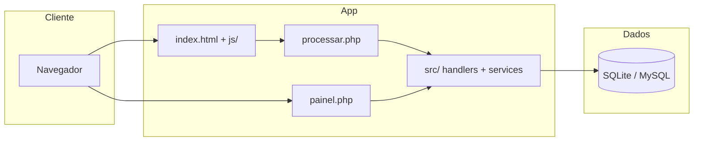

# CDT Jacarepaguá — Cadastro Financeiro

Sistema web para **filiação digital** da unidade **CDT Jacarepaguá** (Cartão de TODOS): formulário em duas etapas, API PHP, painel administrativo, conformidade LGPD/PCI (sem persistência de PAN/CVV) e deploy local ou na **AWS** (ECS ou AWS Academy).

| Documento | Público |
|-----------|---------|
| **[Documentação completa da solução](docs/documentacao-solucao-completa.md)** | Arquitetura, dados, segurança, operação, ADRs |
| **[RED — Registro de Especificação de Desenvolvimento](docs/RED.md)** | Requisitos, RFs/RNFs, critérios de aceite |
| **[Publicação AWS (conta completa)](docs/aws-publicacao.md)** | ECS Fargate, RDS, ECR, Terraform |
| **[Homologação e domínio HTTPS](docs/aws-homolog-e-dominio.md)** | Workspace `homolog`, ACM, Route 53 |
| **[AWS Academy / Vocareum](docs/aws-academy-ec2.md)** | EC2 + Apache/PHP + SQLite |

---

## Visão arquitetural

Monólito **modular PHP 8.2** (PSR-4 em `src/`) com front-end estático (HTML + ES modules + Tailwind). A camada HTTP delega para **services** e **repositories**; o cartão passa por **tokenização** antes da gravação. O mesmo artefato roda em SQLite (dev/Academy) ou MySQL (produção).



**Perfis de implantação**

| Perfil | Compute | Banco | Provisionamento |
|--------|---------|-------|-----------------|
| Local | `php -S` ou XAMPP | SQLite em `data/` | Manual (`.env`) |
| Docker dev | `docker compose` | MySQL 8 | `docker-compose.yml` |
| AWS produção/homolog | ECS Fargate + ALB | RDS MySQL | `infra/terraform/` + scripts PowerShell |
| AWS Academy | EC2 (Apache + PHP) | SQLite em `/var/www/html/data` | `scripts/academy-launch-ec2.ps1` |

Imagem opcional para contas completas: **Dockerfile** multi-stage (build Tailwind com Node 22 → `php:8.2-apache`).

---

## Funcionalidades

- Formulário guiado em **dois passos**; ao abrir a página o foco vai para o campo **Nome** (cadastro imediato).
- Validação **client-side** (Vitest) e **server-side** (CPF, Luhn, CEP, idade, validade).
- Feedback de erros em **modais** (sem `alert`); bloco de depuração só com `APP_DEBUG=true`.
- API JSON (`POST /processar.php`) com CSRF e rate limit.
- Gateway de pagamento **mock** (padrão) ou **Stripe** (opcional).
- Painel admin: login por senha (bcrypt), listagem paginada, export CSV, exclusão LGPD, purga por retenção.
- Critérios de aceite automatizados (**CA01–CA10** em PHPUnit), Vitest e Playwright.
- CI: PHPUnit (cobertura ≥ 99,9% em `src/`), Vitest, Playwright.

---

## Requisitos

| Ferramenta | Versão |
|------------|--------|
| PHP | 8.2+ (`pdo_sqlite` ou `pdo_mysql`, `session`, `json`) |
| Composer | 2.x |
| Node.js | 20+ (22 no CI/Docker) |

No Windows, se o PHP não estiver no `PATH`, use caminho completo (ex.: `C:\xampp\php\php.exe`) e defina `PHP_BIN` para o Playwright.

---

## Início rápido (SQLite)

```bash
cp .env.example .env   # no PowerShell: copy .env.example .env
```

1. Gere o hash do painel e cole em `ADMIN_PASSWORD_HASH` no `.env`:

```bash
php -r "echo password_hash('sua-senha', PASSWORD_DEFAULT), PHP_EOL;"
```

2. Instale dependências e CSS:

```bash
composer install
npm install
npm run build:css
```

3. Suba o servidor embutido:

```bash
php -S 127.0.0.1:8080 -t .
```

| URL | Descrição |
|-----|-----------|
| http://127.0.0.1:8080/index.html | Formulário público |
| http://127.0.0.1:8080/painel.php | Painel administrativo |

O SQLite é criado/atualizado automaticamente em `data/cdt.sqlite` quando `DB_DRIVER=sqlite`.

---

## Docker (MySQL local)

```bash
docker compose up
```

A aplicação fica em **http://localhost:8080**. O MySQL expõe a porta **3307** no host. Na primeira execução, importe o schema se necessário:

```bash
docker compose exec db mysql -ucdt -pcdt cdt < sql/schema.sql
```

Para teste local com SQLite em container, use `docker-compose.academy.yml`.

---

## Variáveis de ambiente

Referência completa em [`.env.example`](.env.example).

| Variável | Descrição | Padrão / notas |
|----------|-----------|----------------|
| `APP_ENV` | `local`, `testing`, `production`, `staging` | Afeta mensagens e ambiente |
| `APP_DEBUG` | Inclui `depuracao` no JSON de erros | `false` em produção |
| `DB_DRIVER` | `sqlite` ou `mysql` | `sqlite` no exemplo |
| `DB_DATABASE` | Caminho SQLite ou nome do banco | `data/cdt.sqlite` |
| `DB_HOST`, `DB_PORT`, `DB_USERNAME`, `DB_PASSWORD` | MySQL | Obrigatórios se `mysql` |
| `ADMIN_PASSWORD_HASH` | Senha do painel (`password_hash`) | **Obrigatório** |
| `CORS_ALLOWED_ORIGINS` | Origens CSV; vazio = mesma origem | |
| `SESSION_SECURE` | Cookie só em HTTPS | `true` com TLS |
| `PAYMENT_GATEWAY` | `mock` ou `stripe` | `mock` |
| `STRIPE_SECRET_KEY` | Chave Stripe | Se gateway `stripe` |
| `RATE_LIMIT_CADASTRO_MAX` | Máx. cadastros por IP | `20` |
| `RATE_LIMIT_CADASTRO_WINDOW` | Janela em segundos | `3600` |
| `PAINEL_PAGE_SIZE` | Paginação do painel | `15` |
| `LGPD_RETENTION_DAYS` | Purga automática; `0` desliga | Painel 1×/24h ou `php scripts/lgpd-purge.php` |

**AWS (ECS):** banco, hash do admin e Stripe no **Secrets Manager** — ver `infra/terraform/secrets.tf`.

---

## Segurança e conformidade

- **PCI (princípio):** PAN e CVV não são persistidos; gravam-se últimos 4 dígitos, bandeira e token opaco do gateway.
- **LGPD:** exclusão por registro no painel; CPF mascarado na UI e no CSV; retenção configurável.
- **Controles:** CSRF (`csrf-token.php`), rate limit, `PayloadSanitizer` com `APP_DEBUG=false`, CORS, sessão admin com regeneração pós-login.

Detalhamento: [documentacao-solucao-completa.md — seção 6](docs/documentacao-solucao-completa.md).

---

## Testes

```bash
php vendor/bin/phpunit
npm run test:unit
npx playwright test
```

Windows (PHPUnit sem `vendor/bin`):

```powershell
C:\xampp\php\php.exe vendor\phpunit\phpunit\phpunit -c phpunit.xml
$env:PHP_BIN = 'C:\xampp\php\php.exe'
.\scripts\run-all-tests.ps1
```

O workflow **[`.github/workflows/ci.yml`](.github/workflows/ci.yml)** roda na branch `main` e em PRs. Deploy ECS: **[`.github/workflows/deploy-aws.yml`](.github/workflows/deploy-aws.yml)** (OIDC na conta AWS).

---

## Publicação na AWS

### Conta completa (produção / homolog com ECS)

```powershell
# 1. aws configure (ou SSO)
# 2. Hash do painel em infra\terraform\terraform.tfvars ou terraform.homolog.tfvars
.\scripts\aws-provision.ps1              # ou aws-provision-homolog.ps1
.\scripts\aws-db-migrate.ps1
.\scripts\aws-publish.ps1                # -ProjectName cdt ou cdt-hml
```

Atalho guiado: [`scripts/aws-setup-completo.ps1`](scripts/aws-setup-completo.ps1)  
Documentação: [docs/aws-publicacao.md](docs/aws-publicacao.md), [docs/aws-homolog-e-dominio.md](docs/aws-homolog-e-dominio.md).

### AWS Academy (Learner Lab / Vocareum)

A conta acadêmica **não permite** ECS, RDS e criação de IAM como no Terraform completo. O fluxo suportado é:

1. **AWS CLI** configurada (`credentials` + `config`, região típica **`us-east-1`**).
2. `terraform.homolog.tfvars` com `admin_password_hash` (gerado localmente).
3. Publicação automática:

```powershell
.\scripts\academy-launch-ec2.ps1           # nova instância
.\scripts\academy-launch-ec2.ps1 -Replace  # recria EC2 e republica o código
```

O script envia o projeto como **`.tar.gz`** para S3, sobe **EC2 Amazon Linux 2023**, instala **Apache + PHP**, extrai em `/var/www/html` e grava `.env` com SQLite.  
Senha do painel de homolog (se gerada pelo script): `data\.painel-homolog.local.txt` — **não versionar**.

Aguarde **2–4 minutos** após o script e acesse a URL exibida no terminal (`http://<IP>/index.html`).

Guia e troubleshooting: [docs/aws-academy-ec2.md](docs/aws-academy-ec2.md).

---

## Estrutura do repositório

```
cdt/
├── index.html, painel.php, processar.php   # Entradas HTTP na raiz
├── csrf-token.php, config-public.php      # Auxiliares do front
├── src/                    # Domínio PHP (App\)
│   ├── Http/               # Handlers, CORS, JSON, sanitizer
│   ├── Service/            # Cadastro, retenção LGPD
│   ├── Repository/         # PDO, schema, CRUD
│   ├── Payment/            # Mock, Stripe, factory
│   ├── Security/           # CSRF, sessão, rate limit, auth
│   └── View/               # HTML do painel
├── js/                     # Front-end modular + validação + modal
├── CSS/                    # Tailwind (input.css → app.css)
├── sql/schema.sql          # DDL MySQL de referência
├── tests/                  # Unit, integration, acceptance, e2e
├── infra/terraform/        # VPC, ECS, RDS, ALB, ECR, IAM, DNS
├── scripts/                # AWS, LGPD, Academy
├── docker/                 # Apache vhost, php.ini
├── docs/                   # Arquitetura, RED, guias AWS
├── Dockerfile
├── docker-compose.yml
└── docker-compose.academy.yml
```

---

## API HTTP (resumo)

| Recurso | Método | Função |
|---------|--------|--------|
| `/index.html` | GET | Formulário |
| `/processar.php` | POST | Cadastro (JSON) |
| `/csrf-token.php` | GET | Token CSRF |
| `/config-public.php` | GET | Flag `debug` para o front |
| `/painel.php` | GET/POST | Login, lista, delete, export CSV |

Contrato detalhado: [RED — seção 7](docs/RED.md) e [documentação completa — seção 8](docs/documentacao-solucao-completa.md).

---

## Manutenção da documentação

Ao alterar arquitetura, requisitos ou infraestrutura:

1. Atualize [docs/documentacao-solucao-completa.md](docs/documentacao-solucao-completa.md) (versão e data no cabeçalho).
2. Ajuste [docs/RED.md](docs/RED.md) se houver mudança em RF/RNF ou aceite.
3. Revise este README e os guias em `docs/aws-*.md`.

---

## Licença

Projeto acadêmico proprietário (`composer.json`: `proprietary`). Uso conforme orientação da instituição e da operação CDT.