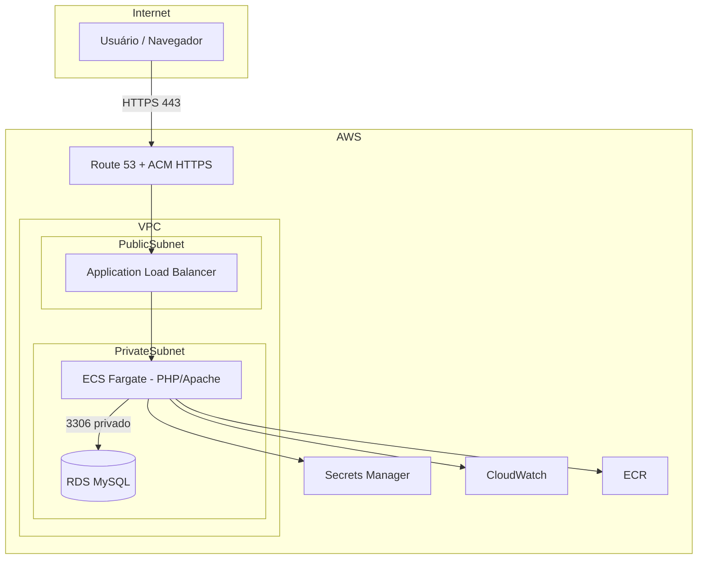
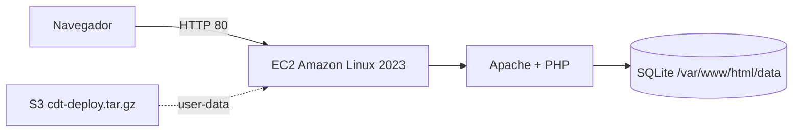
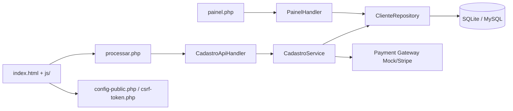

# CENTRO UNIVERSITÁRIO AUGUSTO MOTTA (UNISUAM)

**CURSO SUPERIOR DE TECNOLOGIA EM ANÁLISE E DESENVOLVIMENTO DE SISTEMAS**

**CDT Jacarepaguá — Documentação de Entrega Final do Projeto de Infraestrutura e Arquitetura AWS**

**Cadastro Financeiro – Cartão de TODOS**

---

**Integrantes:**

- Anna Bárbara Silva Kmiciak dos Santos  
- Mayara de Jesus Lima  
- Nathally Nicoli  

**Entrega Final do projeto**

**Professor:** Silvio Eutimio  

**Rio de Janeiro – Bangu (UNISUAM)**

**Data:** 2026

**Repositório:** https://github.com/AnnaBarbara5/cdt

---

> **Cabeçalho de páginas internas (layout acadêmico)**  
> `UNISUAM • Análise e Desenvolvimento de Sistemas` | **Página _N_**  
> `DOCUMENTAÇÃO DE ENTREGA FINAL | INFRAESTRUTURA E ARQUITETURA AWS`  
> `CDT JACAREPAGUÁ — Cadastro Financeiro – Cartão de TODOS`  
> Rodapé: `CDT JACAREPAGUÁ | Documentação Entrega Final — Infraestrutura e Arquitetura AWS`

---

## PROJETO DE INFRAESTRUTURA E ARQUITETURA [ADS0401M]

### CDT Jacarepaguá — Sistema de Cadastro Financeiro

| Bloco | Texto |
|--------|--------|
| **PROPOSTA** | Desenvolver uma infraestrutura em nuvem computacional na **AWS** para hospedar a aplicação web de **cadastro financeiro** da unidade **CDT Jacarepaguá** (Cartão de TODOS), com camadas de rede, segurança, processamento, armazenamento e monitoramento, suportando também o perfil **AWS Academy (Vocareum)** quando os serviços gerenciados (ECS, RDS, IAM amplo) não estiverem disponíveis. |
| **PRODUTO** | Aplicação web implantada em infraestrutura **Cloud Computing (AWS)**, composta por formulário público, API PHP, painel administrativo, banco relacional (MySQL em produção ou SQLite em homologação/lab), pipeline de qualidade (CI) e **Infraestrutura como Código (Terraform)** para contas completas. |
| **RESULTADO ESPERADO** | Apresentar testes na infraestrutura criada, demonstrando que a solução suporta a aplicação implantada, utilizando de forma eficiente os principais serviços configurados na plataforma AWS, com evidências de **critérios de aceite CA-01 a CA-10**, testes automatizados (PHPUnit, Vitest, Playwright) e documentação técnica versionada no GitHub. |
| **OBJETIVO GERAL** | Implantar e documentar uma arquitetura de nuvem para a utilização da aplicação web de cadastro financeiro CDT, garantindo disponibilidade, segurança de dados sensíveis (sem persistência de PAN/CVV), conformidade com boas práticas LGPD e capacidade de publicação em ambientes acadêmicos e operacionais. |
| **OBJETIVOS ESPECÍFICOS** | • Criar um modelo de implantação de infraestrutura como serviço (IaaS/PaaS híbrido) com **Terraform** (ECS, RDS, ALB, ECR, Secrets Manager) e perfil alternativo **EC2 + Apache/PHP** para AWS Academy. • Montar a infraestrutura conforme o modelo proposto e publicar artefatos (imagem Docker, scripts PowerShell). • Avaliar o comportamento da infraestrutura implantada por meio de testes funcionais, de integração, de aceite e E2E, utilizando a aplicação instalada. • Consolidar documentação de arquitetura, operação, segurança e entrega final alinhada ao modelo institucional UNISUAM. |
| **PARTICIPANTES** | Anna Bárbara Silva Kmiciak dos Santos, Mayara de Jesus Lima e Nathally Nicoli. |

---

## 1 Identificação do Grupo e Integrantes

| Campo | Valor |
|--------|--------|
| **Instituição** | UNISUAM — Campus Bangu |
| **Curso** | Análise e Desenvolvimento de Sistemas |
| **Disciplina / eixo** | Infraestrutura e Arquitetura de Sistemas — [ADS0401M] |
| **Integrantes** | Anna Bárbara Silva Kmiciak dos Santos; Mayara de Jesus Lima; Nathally Nicoli |
| **Orientação** | Professor Silvio Eutimio |
| **Tipo de documento** | Documentação de **Entrega Final** (evolução do pré-projeto GR-03) |

---

## 2 Título e Cenário / Empresa Escolhida

**Título:** Infraestrutura em Nuvem para o Sistema de Cadastro Financeiro CDT Jacarepaguá.

**Cenário:** aplicação web de apoio ao cadastro de clientes do **Cartão de TODOS**, com formulário de identificação, endereço e seleção da modalidade de pagamento (débito/crédito), painel interno para listagem, exportação CSV e exclusão sob demanda (LGPD).

**Organização beneficiada:** unidade **CDT Jacarepaguá**.

**Repositório de referência e entrega de código:** https://github.com/AnnaBarbara5/cdt

---

## 3 Descrição do Problema ou Necessidade do Negócio

O sistema necessita de um ambiente confiável para executar páginas **PHP**, processar formulários, validar dados cadastrais e proteger informações sensíveis. A ausência de infraestrutura planejada prejudica disponibilidade, manutenção, auditoria e segurança.

**Atenção a dados sensíveis:** por haver campos de pagamento, a solução exige tratamento rigoroso: **não armazenar número completo de cartão (PAN) nem CVV**; tokenização via gateway (mock padrão ou Stripe opcional); mascaramento de CPF no painel e no CSV; CSRF, rate limit e sanitização de respostas em produção.

---

## 4 Objetivo Geral da Solução (implementado)

Disponibilizar a aplicação web na **AWS**, com hospedagem de **PHP 8.2+**, banco relacional (**MySQL/RDS** em conta completa ou **SQLite** no lab), rede segmentada quando aplicável, acesso seguro ao painel (bcrypt), monitoramento (**CloudWatch** em arquitetura ECS), backups e **IaC** versionado, permitindo evolução controlada do sistema.

---

## 5 Estratégia de Implantação

| Fase | Descrição |
|------|-----------|
| **Avaliação do negócio** | Levantamento das necessidades do CDT Jacarepaguá: formulário em duas etapas, validações, painel administrativo, conformidade PCI/LGPD. |
| **Design da nuvem (conta completa)** | Arquitetura em **VPC**: subnets públicas/privadas, **ALB**, **ECS Fargate**, **RDS MySQL**, **ECR**, **Secrets Manager**, **Route 53/ACM** (homologação), definida em `infra/terraform/`. |
| **Design da nuvem (AWS Academy)** | Devido a limites do lab Vocareum (IAM/ECS/RDS), adotou-se **EC2** (Amazon Linux 2023), **Apache + PHP**, **SQLite** local, deploy via **S3** + script `academy-launch-ec2.ps1` (artefato `.tar.gz`). |
| **Implementação e transição** | Código modular PSR-4 em `src/`; front com Tailwind e ES modules; Dockerfile multi-stage; workflows CI (`ci.yml`) e deploy (`deploy-aws.yml`). |
| **Suporte operacional** | Logs de aplicação, rate limiting, purga LGPD (`DataRetentionService`, `scripts/lgpd-purge.php`), documentação em `docs/`. |
| **Apresentação** | Demonstração da aplicação via URL pública da EC2 (lab) ou ambiente homolog; evidências de testes CA-01 a CA-10. |

---

## 6 Entregas do Projeto

| Atividade | Descrição |
|-----------|-----------|
| **Escopo** | Infraestrutura em nuvem **AWS** para hospedar o sistema de cadastro financeiro CDT, incluindo formulário, API, painel, segurança de dados de cartão e publicação documentada. |
| **Cronograma** | Planejamento, desenvolvimento, testes, documentação e entrega final (ver seção 8). |
| **Definição HW/SW** | EC2/ECS, EBS, RDS ou SQLite, Linux, Apache, PHP 8.2, Node.js (build CSS), Docker opcional. |
| **Capacidade de computação** | Dimensionamento inicial: **t3.micro/t2.micro** (lab); ECS Fargate com autoscaling em conta completa. |
| **Redes e segurança** | Security Groups, HTTPS (ALB/ACM), VPC, CSRF, sessão, secrets fora do repositório. |
| **Armazenamento** | EBS (EC2), RDS (MySQL), S3 (artefato de deploy no lab), diretório `data/` para SQLite. |
| **Softwares e aplicações** | Monólito modular PHP; repositório GitHub; Terraform; scripts PowerShell. |
| **Hospedagem na Cloud** | Perfis: Local, Docker Compose, ECS+RDS, Academy EC2. |
| **Testes** | PHPUnit (55 testes), Vitest, Playwright; critérios de aceite automatizados. |
| **Plano de transição** | Do desenvolvimento local para homolog AWS Academy; evolução para ECS/RDS em conta com permissões IAM. |

---

## 7 Escopo do Projeto

### 7.1 Dentro do escopo (entregue)

- Aplicação web completa (formulário, API, painel).
- Validação client/server; tokenização; sem PAN/CVV persistidos.
- Infraestrutura como Código (Terraform) para conta AWS completa.
- Perfil AWS Academy (EC2 + Apache/PHP + SQLite).
- CI com PHPUnit, Vitest, Playwright.
- Documentação: RED, solução completa, publicação AWS, este documento de entrega final.

### 7.2 Fora do escopo

- Liquidação financeira real e certificação PCI formal.
- Aplicativo móvel nativo.
- Autenticação corporativa (SSO/Azure AD).

---

## 8 Cronograma das Atividades (Entrega Final)

| Atividade | Responsável | Início | Fim | Status |
|-----------|-------------|--------|-----|--------|
| Levantamento de requisitos | Anna Bárbara e Mayara | — | — | Concluído |
| Pré-projeto de infraestrutura AWS | Nathally | — | — | Concluído |
| Desenho da arquitetura e implementação PHP | Anna Bárbara | — | — | Concluído |
| Planejamento de rede e segurança | Anna Bárbara | — | — | Concluído |
| Terraform ECS/RDS e scripts de publicação | Mayara e Nathally | — | — | Concluído |
| Perfil AWS Academy (EC2) | Anna Bárbara | — | — | Concluído |
| Testes (unitários, integração, aceite, E2E) | Mayara | — | — | Concluído |
| Publicação no GitHub e documentação final | Todas | — | 2026 | Concluído |
| Entrega Final | Todas | — | 2026 | Concluído |

*Observação: no pré-projeto (GR-03) as atividades constavam como “Planejado”; nesta entrega final o status reflete a implementação e publicação efetivas.*

---

## 9 Informações sobre o Sistema e a Aplicação

O sistema implantado na nuvem é a aplicação **Cadastro Financeiro CDT Jacarepaguá**, que permite:

- Cadastro em **duas etapas** (dados pessoais e pagamento).
- Validação de CPF, CEP, idade, Luhn e validade do cartão.
- Submissão via **POST** para `processar.php` (JSON).
- **Painel administrativo** (`painel.php`): login por senha hash, paginação, export CSV, exclusão LGPD.

### 9.1 Stack de software

| Camada | Tecnologia |
|--------|------------|
| Front-end | HTML5, Tailwind CSS, JavaScript (ES modules) |
| Back-end | PHP 8.2+, PSR-4 (`src/`) |
| Banco | SQLite (dev/Academy) ou MySQL 8 (Docker/ RDS) |
| Qualidade | PHPUnit 11, Vitest, Playwright |
| Container | Dockerfile multi-stage (Node + php-apache) |
| IaC | Terraform 1.x (`infra/terraform/`) |

### 9.2 Informações técnicas — perfil AWS Academy (implantação demonstrada)

| Item | Definição |
|------|-----------|
| **Nome da instância** | `cdt-hml` (recriável com `-Replace` no script) |
| **Tipo de instância** | **t2.micro** ou **t3.micro** (conforme cota do lab) |
| **AMI** | Amazon Linux 2023 |
| **Stack no host** | **Apache + PHP 8.x** (sem Docker obrigatório no micro do lab) |
| **Banco** | SQLite em `/var/www/html/data` |
| **Deploy** | Pacote `cdt-deploy.tar.gz` no S3; user-data instala dependências e extrai aplicativo |
| **Script** | `scripts/academy-launch-ec2.ps1` |
| **Região típica do lab** | `us-east-1` |
| **Security Group** | HTTP **80** (teste público); SSH **22** (administração) |
| **URL de acesso** | `http://<IP-publico-da-EC2>/index.html` (IP efêmero a cada reprovisionamento) |

*IDs específicos de instância (i-…), VPC e subnet variam a cada execução no Vocareum; registre no relatório de banca o IP e print do console EC2 da sessão de demonstração.*

### 9.3 Informações técnicas — perfil conta AWS completa (Terraform)

| Serviço | Função |
|---------|--------|
| **Amazon VPC** | Isolamento de rede; subnets pública/privada |
| **Application Load Balancer** | Entrada HTTPS; health check |
| **Amazon ECS (Fargate)** | Execução de containers da aplicação |
| **Amazon ECR** | Registro da imagem Docker |
| **Amazon RDS (MySQL)** | Dados cadastrais em sub-rede privada |
| **AWS Secrets Manager** | `DB_PASSWORD`, `ADMIN_PASSWORD_HASH`, chaves Stripe |
| **Amazon CloudWatch** | Logs e métricas |
| **Route 53 + ACM** | Domínio e TLS (homologação documentada) |

---

## 10 Capacidade de Computação

### Perfil Academy (lab)

- **Instância:** Amazon EC2 — t2.micro / t3.micro (1 vCPU, 1 GiB RAM típico).
- **Armazenamento:** EBS General Purpose SSD (8–30 GiB conforme AMI/padrão da conta).
- **Sistema operacional:** Amazon Linux 2023 (64 bits).

### Perfil produção/homolog (Terraform)

- **ECS Fargate:** CPU/memória definidas na task definition (`infra/terraform/ecs.tf`).
- **RDS:** classe `db.t3.micro` ou superior em homolog; storage autoscaling configurável.
- **Modo economia:** variáveis para `cost_saver_mode` em homolog (documentado em `docs/aws-homolog-e-dominio.md`).

---

## 11 Necessidades de Rede e Segurança

| Controle | Descrição |
|----------|-----------|
| **SSH (22)** | Restrito a administração; chave `.pem` no lab |
| **HTTP/HTTPS (80/443)** | Acesso público ao formulário; HTTPS via ALB+ACM na arquitetura completa |
| **RDS (3306)** | Somente a partir da sub-rede da aplicação (sem acesso público) |
| **Security Groups** | Liberação mínima de portas; revisão periódica |
| **Aplicação** | CSRF em POST; rate limit por IP; sessão segura com `SESSION_SECURE` em TLS |
| **Dados** | Sem PAN/CVV; CPF mascarado no painel; `PayloadSanitizer` sem `depuracao` em produção |
| **Credenciais** | `.env` local ignorado no Git; Secrets Manager na AWS |
| **Painel** | `ADMIN_PASSWORD_HASH` (bcrypt); sem usuário/senha em texto plano no código |

---

## 12 Principais Recursos da Plataforma (funcionalidades)

- **Formulário guiado em duas etapas** com foco automático no campo Nome e validação em tempo real.
- **Máscaras e validação client-side** (CPF, CEP, telefone, cartão) com testes Vitest.
- **API JSON** com catálogo de erros padronizado e códigos (`ValidationErrorCatalog`).
- **Tokenização** antes da gravação (`MockPaymentGateway` ou Stripe).
- **Painel administrativo:** paginação, export CSV com CPF mascarado, exclusão por registro (LGPD).
- **Retenção configurável** (`LGPD_RETENTION_DAYS`) com purga automática e script CLI.
- **CI/GitHub Actions:** PHPUnit com meta de cobertura ≥ 99,9% em `src/`, Vitest, Playwright.

---

## 13 Princípios de Design da Arquitetura na AWS

| Princípio | Aplicação no CDT |
|-----------|------------------|
| **Custo-efetividade** | t2/t3.micro no lab; Fargate + RDS dimensionáveis; homolog com modo econômico |
| **Segurança em camadas** | VPC, SG, HTTPS, secrets externos, PCI (sem PAN/CVV), CSRF, rate limit |
| **Confiabilidade** | Health checks no ALB; snapshots RDS/EBS em conta operacional; backups S3 |
| **Escalabilidade** | ECS permite aumentar tasks; ALB distribui carga |
| **Portabilidade** | Mesmo código PHP em SQLite ou MySQL (`ConnectionFactory`) |
| **Observabilidade** | CloudWatch logs; testes automatizados como rede de segurança |

---

## 14 Principais Componentes da Arquitetura AWS para o CDT Jacarepaguá

### 14.1 Serviços de computação

- **Amazon EC2:** hospedagem no perfil Academy (Apache/PHP).
- **Amazon ECS (Fargate):** hospedagem containerizada na conta completa.
- **AWS Elastic Beanstalk:** citado no pré-projeto como alternativa simplificada; a entrega consolidou **ECS + Terraform** como caminho principal.

### 14.2 Armazenamento e bancos de dados

- **SQLite** em arquivo (dev e Academy).
- **Amazon RDS (MySQL)** para produção/homolog terraformada.
- **Amazon S3:** bucket de artefato de deploy no script Academy.
- **Amazon EBS:** volume da instância EC2.

### 14.3 Rede e segurança

- **Amazon VPC**, sub-redes, **Internet Gateway**, **Security Groups**.
- **AWS IAM** (conta completa) para papéis de execução ECS e leitura de secrets.
- **AWS Certificate Manager (ACM)** para TLS no ALB.

### 14.4 Monitoramento e operação

- **Amazon CloudWatch** (logs ECS, métricas de instância).
- **GitHub Actions** (`ci.yml`, `deploy-aws.yml`).

---

## 15 Hospedagem na Nuvem — Formas de Disponibilização

| Perfil | Como publicar | Documentação |
|--------|---------------|--------------|
| **Local / XAMPP** | `php -S` ou Apache local, SQLite | `README.md` |
| **Docker** | `docker compose up` | `docker-compose.yml` |
| **AWS conta completa** | Terraform + ECR + ECS + RDS | `docs/aws-publicacao.md` |
| **AWS Academy** | `.\scripts\academy-launch-ec2.ps1` | `docs/aws-academy-ec2.md` |

**Fluxo Academy (resumo):** empacota projeto → envia ao S3 → cria EC2 com user-data → instala Apache/PHP → extrai `tar.gz` → aplica hash do painel → expõe HTTP na porta 80.

---

## 16 Testes Realizados

Testes rigorosos para validar o projeto CDT hospedado e a base de código:

| Tipo | Evidência |
|------|-----------|
| **Critérios de aceite CA-01 a CA-10** | `tests/Acceptance/AcceptanceCriteriaTest.php` — cadastro sem PAN/CVV, validação, CSRF, sanitização, máscara CPF, paginação, admin hash, rate limit, gateway mock, exclusão LGPD |
| **PHPUnit (completo)** | 55 testes (unitários, integração, aceite) |
| **Vitest** | Validações JavaScript do formulário |
| **Playwright** | E2E do fluxo de cadastro (`tests/e2e/cadastro.spec.js`) |
| **Acesso e conectividade** | HTTP ao IP público da EC2; verificação de `index.html` e `processar.php` |
| **Navegação e responsividade** | Formulário em desktop e mobile (Tailwind) |
| **Integridade de dados** | Persistência SQLite/MySQL; campos de cartão apenas token + últimos 4 dígitos |
| **Segurança** | 403 sem CSRF; resposta sem campo `depuracao` com `APP_DEBUG=false` |

**Condição de aceite do RED:** todos os CA-01 a CA-10 passando no CI/local documentado.

---

## 17 Modelo de Desenho de Solução de Arquitetura Física e Lógica

### 17.1 Diagrama lógico — conta AWS completa (alvo)

### 17.2 Diagrama lógico — AWS Academy (implantado no lab)

### 17.3 Diagrama de componentes da aplicação

**Representação de design de solução:** os diagramas acima substituem a lâmina visual do modelo Pet.Joy; podem ser exportados para PNG/SVG a partir do Markdown ou do GitHub para anexar ao PDF institucional.

---

## 18 Levantamento dos Requisitos de Infraestrutura (consolidado)

| Categoria | Requisito | Status |
|-----------|-----------|--------|
| Aplicação | Servidor Linux com PHP 8.2+ e Apache | Atendido |
| Dados | MySQL gerenciado (RDS) ou SQLite (lab) | Atendido |
| Rede e segurança | VPC, SG, HTTPS (conta completa), CSRF, rate limit | Atendido / parcial HTTPS no lab HTTP |
| Armazenamento | EBS, S3, backups RDS planejados | Atendido |
| Operação | CloudWatch, CI GitHub Actions | Atendido |
| Conformidade | Sem PAN/CVV; LGPD exclusão/retencão | Atendido |

---

## 19 Serviços AWS Utilizados e Justificativa

| # | Serviço | Justificativa |
|---|---------|---------------|
| 1 | **Amazon EC2** | Compute no AWS Academy e bastion/alternativa |
| 2 | **Amazon ECS Fargate** | Execução elástica de containers na conta completa |
| 3 | **Amazon RDS (MySQL)** | Banco gerenciado, backups, rede privada |
| 4 | **Amazon EBS / S3** | Disco da EC2; artefatos de deploy |
| 5 | **Amazon VPC / Security Groups** | Segmentação e firewall |
| 6 | **AWS IAM / Secrets Manager / ACM** | Permissões, segredos e TLS |
| 7 | **Amazon CloudWatch** | Logs e métricas |
| 8 | **Amazon ECR** | Imagens Docker versionadas |

---

## 20 Definição de Computação, Redes, Segurança e Armazenamento

| Área | Definição |
|------|-----------|
| **Computação** | EC2 micro no lab; Fargate com task CPU/memória definidas no Terraform |
| **Redes** | Sub-rede pública (ALB/EC2 web); sub-rede privada (RDS); porta 3306 restrita |
| **Segurança** | HTTPS, IAM mínimo, secrets protegidos, validação de entradas, backup |
| **Armazenamento** | EBS SO/app; RDS dados; S3 deploy/backups |

---

## 21 Referências

| Referência | Link / local |
|------------|----------------|
| Repositório CDT | https://github.com/AnnaBarbara5/cdt |
| Documentação AWS | https://docs.aws.amazon.com/ |
| RED do projeto | `docs/RED.md` |
| Solução completa | `docs/documentacao-solucao-completa.md` |
| Pré-projeto institucional | `2026-2-BG-PREPROJETO-INFRA-GR-03_1.pdf` |
| Modelo entrega final (formato) | `2026-1-GR-01_-_Documentacao_Entrega_Final.pdf` |
| Modelo acadêmico citado no pré-projeto | 2026-02-BG-PROJETO-INFRA-GR-12.pdf |

---

## 22 Aprovações

| Papel | Nome | Data | Assinatura |
|-------|------|------|------------|
| Integrante | Anna Bárbara Silva Kmiciak dos Santos | ___/___/______ | |
| Integrante | Mayara de Jesus Lima | ___/___/______ | |
| Integrante | Nathally Nicoli | ___/___/______ | |
| Professor | Silvio Eutimio | ___/___/______ | |

---

*Fim do documento — Documentação de Entrega Final — CDT Jacarepaguá — Infraestrutura e Arquitetura AWS — UNISUAM Bangu — 2026.*