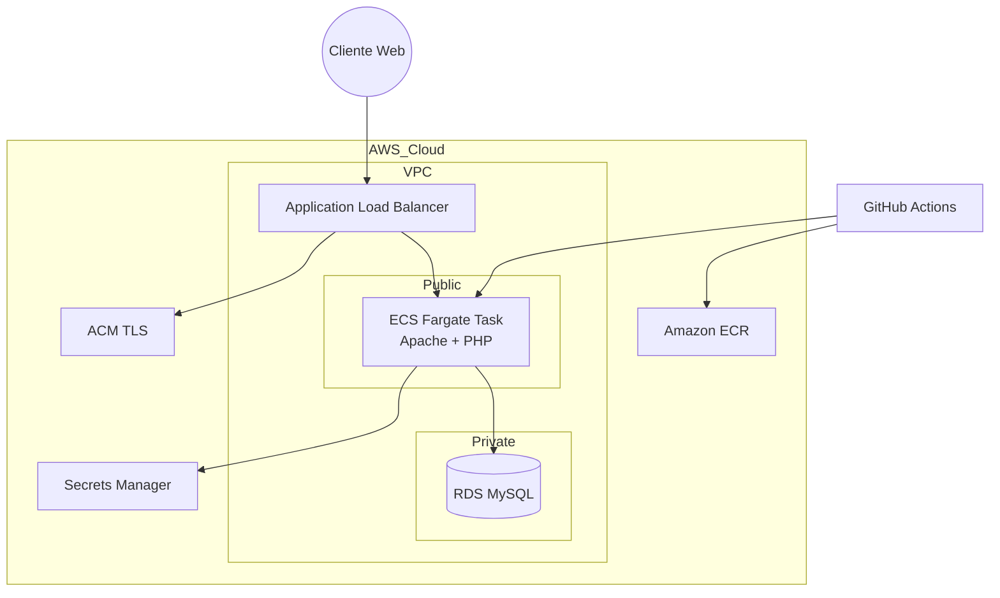
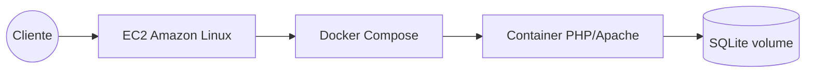

# RED — Registro de Especificação de Desenvolvimento

**Projeto:** Sistema de Cadastro Financeiro — CDT Jacarepaguá (Cartão de TODOS)  
**Sigla do documento:** RED  
**Versão:** 1.0  
**Status:** Aprovado para implementação entregue  
**Data:** 22/11/2025  

---

## Controle de documento

| Campo | Valor |
|-------|-------|
| Autor | Equipe de desenvolvimento CDT |
| Papel do autor | Análise, desenvolvimento e documentação |
| Revisor técnico | A definir (docente / orientador) |
| Classificação | Uso acadêmico e operação interna |
| Repositório | `c:\Projetos\cdt` (estrutura `src/`, `infra/terraform/`, `docs/`) |

### Histórico de revisões

| Versão | Data | Descrição |
|--------|------|-----------|
| 1.0 | 22/11/2025 | Emissão inicial consolidando pré-projeto, implementação e infraestrutura AWS |

---

## 1. Introdução

### 1.1 Finalidade do RED

Este **Registro de Especificação de Desenvolvimento (RED)** formaliza o que será e foi construído no sistema de cadastro financeiro da unidade CDT Jacarepaguá: requisitos, arquitetura, interfaces, dados, segurança, testes e critérios de aceite. Serve como contrato técnico entre stakeholders acadêmicos e a base de código implantável.

### 1.2 Referências

- Pré-projeto de infraestrutura AWS (disciplina / brief institucional).
- PCI DSS — boas práticas de não armazenamento de PAN/CVV.
- LGPD — Lei nº 13.709/2018 (minimização, exclusão, retenção).
- Documentação complementar: [documentacao-solucao-completa.md](documentacao-solucao-completa.md).

### 1.3 Definições e siglas

Conforme glossário da documentação completa (CDT, PAN, PSP, ECS, ALB, CSRF, RDS, ECR, LGPD).

---

## 2. Descrição do problema

### 2.1 Situação atual (AS-IS)

Cadastro financeiro realizado de forma manual ou em canais dispersos, com risco de inconsistência de dados e exposição inadequada de dados de cartão.

### 2.2 Situação desejada (TO-BE)

Canal web único, validado e auditável, com:

- Formulário guiado em duas etapas.
- Validação forte de CPF, idade, endereço e cartão.
- Armazenamento seguro (sem PAN/CVV).
- Painel para operação interna.
- Possibilidade de hospedagem em AWS (conta completa ou Academy).

### 2.3 Stakeholders

| Stakeholder | Interesse |
|-------------|-----------|
| Beneficiário / cliente | Cadastro simples e confiável |
| Equipe CDT / administrativo | Consulta, exportação e exclusão de cadastros |
| Instituição de ensino | Avaliação técnica, AWS, testes |
| Desenvolvimento | Manutenibilidade, CI, IaC |

---

## 3. Objetivos do sistema

| ID | Objetivo | Métrica de sucesso |
|----|----------|-------------------|
| OBJ-01 | Capturar cadastro financeiro completo | 100% campos obrigatórios validados |
| OBJ-02 | Proteger dados de cartão | Zero persistência de PAN/CVV (testes CA-01) |
| OBJ-03 | Disponibilizar painel administrativo | Login com hash, listagem paginada |
| OBJ-04 | Suportar deploy AWS | Terraform + ECS + RDS documentados |
| OBJ-05 | Automatizar qualidade | CI com PHPUnit, Vitest, Playwright |

---

## 4. Escopo

### 4.1 Funcionalidades incluídas

- **RF** listados na seção 5.1.
- Infraestrutura Terraform (produção/homolog).
- Perfil Academy (EC2 + SQLite).
- Scripts PowerShell de provisionamento e publicação.

### 4.2 Exclusões

- Liquidação financeira real.
- Emissão de cartão físico / integração operadora.
- Autenticação federada (Azure AD, etc.).

---

## 5. Requisitos

### 5.1 Requisitos funcionais

| ID | Requisito | Prioridade | Status |
|----|-----------|------------|--------|
| RF-01 | Formulário em 2 passos (dados pessoais + pagamento) | Alta | Implementado |
| RF-02 | Máscaras e validação client-side (CPF, CEP, cartão, telefone) | Alta | Implementado |
| RF-03 | Submissão via POST para API JSON | Alta | Implementado |
| RF-04 | Validação server-side espelhada | Alta | Implementado |
| RF-05 | Tokenização de cartão antes de gravar | Alta | Implementado |
| RF-06 | Persistir cadastro em banco relacional | Alta | Implementado |
| RF-07 | Painel: autenticação por senha | Alta | Implementado |
| RF-08 | Painel: listagem paginada | Média | Implementado |
| RF-09 | Painel: export CSV com CPF mascarado | Média | Implementado |
| RF-10 | Painel: exclusão de registro (LGPD) | Alta | Implementado |
| RF-11 | Purga por política de retenção configurável | Média | Implementado |
| RF-12 | Mensagens de erro amigáveis com códigos | Média | Implementado |
| RF-13 | Seleção débito/crédito | Alta | Implementado |
| RF-14 | Gateway mock; Stripe opcional | Média | Implementado |

### 5.2 Requisitos não funcionais

| ID | Requisito | Critério de verificação | Status |
|----|-----------|-------------------------|--------|
| RNF-01 | PHP 8.2+ | `composer.json` | OK |
| RNF-02 | Tempo de resposta API < 3s (cadastro típico) | Teste manual / homolog | Meta |
| RNF-03 | Disponibilidade alvo 99% (produção AWS) | ALB + health check | Meta operacional |
| RNF-04 | Cobertura de testes PHP em `src/` ≥ 99,9% | CI `ci.yml` | OK |
| RNF-05 | Secrets fora do repositório | `.env`, Secrets Manager | OK |
| RNF-06 | Sessão segura com HTTPS | `SESSION_SECURE` | OK em TLS |
| RNF-07 | Portabilidade SQLite (dev/Academy) e MySQL (prod) | ConnectionFactory | OK |
| RNF-08 | Container reprodutível | Dockerfile multi-stage | OK |
| RNF-09 | IaC versionado | `infra/terraform/` | OK |
| RNF-10 | Acessibilidade básica (labels, contraste Tailwind) | Revisão visual | Parcial |

### 5.3 Regras de negócio

| ID | Regra |
|----|-------|
| RN-01 | Beneficiário deve ter idade mínima configurada na validação |
| RN-02 | CPF pessoal e do titular do cartão validados com dígitos verificadores |
| RN-03 | Cartão validado com algoritmo de Luhn |
| RN-04 | Validade do cartão não pode estar expirada |
| RN-05 | Apenas últimos 4 dígitos e bandeira do cartão são armazenados |
| RN-06 | Administrador único via senha definida em hash (sem usuário em banco) |

---

## 6. Arquitetura da solução

### 6.1 Estilo arquitetural

**Monólito modular** em PHP (camadas Handler → Service → Repository), front-end desacoplado por API JSON, **implantação em container** único por task ECS.

### 6.2 Diagrama de implantação (AWS padrão)

### 6.3 Diagrama de implantação (AWS Academy)

### 6.4 Stack tecnológica

| Camada | Tecnologia |
|--------|------------|
| UI | HTML5, Tailwind CSS 4, JavaScript ES modules |
| Back-end | PHP 8.2, Apache, PSR-4 |
| Dados | SQLite 3 / MySQL 8 (RDS) |
| Build | Node 22 (Tailwind), Composer 2 |
| Testes | PHPUnit 11, Vitest, Playwright |
| Infra | Terraform AWS provider ~5.x |
| CI/CD | GitHub Actions |

---

## 7. Especificação de interfaces

### 7.1 API de cadastro — `POST /processar.php`

**Content-Type:** `application/x-www-form-urlencoded` ou `multipart/form-data`

**Campos principais (representativo):**

| Campo | Obrigatório | Observação |
|-------|-------------|------------|
| `csrf_token` | Sim | Validado na sessão |
| `nome`, `email`, `telefone` | Sim | |
| `cpf_pessoal`, `data_nascimento` | Sim | |
| `cep`, `logradouro`, `numero` | Sim | |
| `pagamento` | Sim | `debito` \| `credito` |
| `cartao`, `validade`, `cvv` | Sim | Não persistidos integralmente |
| `nome_cartao`, `cpf_cartao` | Sim | |

**Respostas:**

| HTTP | Corpo |
|------|-------|
| 200 | `{ "sucesso": true, "mensagem": "...", "id": <int> }` |
| 422 | `{ "sucesso": false, "erros": [ { "codigo", "campo", "mensagem" } ] }` |
| 403 | CSRF inválido |
| 429 | Rate limit |
| 405 | Método não POST |

### 7.2 CSRF — `GET /csrf-token.php`

Retorna JSON com token para o front carregar em `app-config.js`.

### 7.3 Config pública — `GET /config-public.php`

Expõe somente dados não sensíveis (ex.: `APP_ENV`).

### 7.4 Painel — `GET/POST /painel.php`

- Login: POST `senha` + CSRF.
- Listagem: GET `page`.
- Exclusão: POST `delete_id` + CSRF.
- Export: GET `action=export` (autenticado).
- Logout: GET `action=logout`.

---

## 8. Especificação de dados

### 8.1 Modelo lógico (entidade principal)

**ClienteCartao** — atributos alinhados à tabela `clientes_cartao` (ver `sql/schema.sql`).

### 8.2 Dicionário de dados (resumo)

| Atributo | Tipo lógico | Sensibilidade |
|----------|-------------|---------------|
| cpf_pessoal | String(14) | Pessoal — mascarado na UI |
| cartao_ultimos4 | String(4) | Restrito |
| pagamento_token | String(64) | Restrito |
| email, telefone | String | Pessoal |

### 8.3 Retenção e descarte

- Exclusão manual: RF-10.
- Retenção automática: variável `LGPD_RETENTION_DAYS`; execução via `DataRetentionService` e `scripts/lgpd-purge.php`.

---

## 9. Segurança

### 9.1 Ameaças consideradas

| Ameaça | Mitigação |
|--------|-----------|
| XSS | Escape em views PHP; JSON sem HTML |
| CSRF | Token por sessão |
| Força bruta cadastro/login | Rate limiting |
| Vazamento PAN/CVV | Tokenização + não persistir |
| Vazamento credenciais | Secrets Manager / .env |
| Sniffing sessão | `SESSION_SECURE` com HTTPS |

### 9.2 Matriz de controles PCI (escopo simplificado)

| Controle | Atendimento |
|----------|-------------|
| Não armazenar PAN completo | Sim (CA-01) |
| Não armazenar CVV | Sim |
| Criptografia em trânsito (prod) | HTTPS via ALB/ACM |
| Acesso restrito ao painel | Senha + sessão |

### 9.3 LGPD

Base legal e DPO: **responsabilidade do controlador (CDT/instituição)** — o sistema fornece mecanismos técnicos de exclusão e retenção; política de privacidade e termos devem ser publicados pelo negócio.

---

## 10. Plano de testes e critérios de aceite

### 10.1 Estratégia

Testes em quatro níveis (unitário, integração, aceite, E2E) conforme pasta `tests/` e workflow CI.

### 10.2 Matriz de rastreabilidade requisito × teste

| Requisito | Teste / evidência |
|-----------|-------------------|
| RF-04, RF-05 | `AcceptanceCriteriaTest::testCa01...`, `testCa02...` |
| RF-01, RF-03 | `tests/e2e/cadastro.spec.js` |
| RF-07 | `testCa07AutenticacaoAdminComHash` |
| RF-08 | `testCa06PaginacaoRepositorio` |
| RF-10 | `testCa10ExclusaoRegistroLgpd` |
| RNF-05 | `testCa03ApiExigeCsrf`, `testCa04RespostaApiSemDepuracaoEmProducao` |
| RF-05 | `testCa09GatewayMockPadrao` |
| Segurança CPF | `testCa05PainelMascaraCpf` |
| Rate limit | `testCa08RateLimitBloqueiaExcesso` |

### 10.3 Critérios de aceite formal (CA-01 a CA-10)

| CA | Descrição | Resultado esperado |
|----|-----------|-------------------|
| CA-01 | Cadastro completo | Registro no banco sem PAN/CVV |
| CA-02 | Payload inválido | HTTP 422 com erros |
| CA-03 | CSRF obrigatório | 403 sem token; 200 com token |
| CA-04 | Produção sem depuração | Campo `depuracao` removido |
| CA-05 | Máscara CPF | Formato `XXX.***.***-XX` |
| CA-06 | Paginação | `findPage` consistente |
| CA-07 | Admin hash | `password_verify` |
| CA-08 | Rate limit | Bloqueio após limite |
| CA-09 | Gateway padrão | Instância Mock |
| CA-10 | Exclusão LGPD | `deleteById` remove registro |

**Condição de aceite do RED:** todos os CA-01 a CA-10 passando no CI/local documentado.

---

## 11. Implantação e ambientes

| Ambiente | `APP_ENV` | Banco | Hospedagem |
|----------|-----------|-------|------------|
| Local | `local` | SQLite | `php -S` ou Docker MySQL |
| Teste CI | `testing` | SQLite memory | GitHub runner |
| Homolog AWS | `staging` | MySQL RDS | ECS `cdt-hml` |
| Produção AWS | `production` | MySQL RDS | ECS `cdt` |
| Academy | `staging` | SQLite | EC2 + Docker |

### 11.1 Entregáveis de implantação

- Imagem Docker publicada no ECR.
- Task definition ECS atualizada.
- Schema MySQL aplicado (`sql/schema.sql` ou migrate script).
- Secrets preenchidos no Secrets Manager.

---

## 12. Manutenção e suporte

| Atividade | Frequência | Responsável |
|-----------|------------|-------------|
| Atualizar dependências (Composer/npm) | Mensal | Dev |
| Revisar logs CloudWatch | Semanal | Ops |
| Rotacionar senha painel | Trimestral | Admin CDT |
| Validar backups RDS | Mensal | Ops |
| Executar suíte CI antes de merge | Cada PR | Dev |

---

## 13. Riscos

| ID | Risco | Prob. | Impacto | Mitigação |
|----|-------|-------|---------|-----------|
| R-01 | Conta Academy sem ECS | Alta | Médio | Perfil EC2 documentado |
| R-02 | Custo NAT em produção | Média | Médio | `cost_saver_mode` em homolog |
| R-03 | Uso indevido de Stripe sem compliance | Baixa | Alto | Manter mock; checklist PCI |
| R-04 | RDS inacessível para migrate | Média | Médio | Script migrate / bastion |
| R-05 | Senha admin fraca | Média | Alto | Política de senha forte + hash |

---

## 14. Cronograma de marcos (referência acadêmica)

| Marco | Entrega |
|-------|---------|
| M1 | Análise e pré-projeto AWS |
| M2 | Implementação núcleo PHP + front |
| M3 | Testes e CI 100% cobertura PHP |
| M4 | Terraform + documentação deploy |
| M5 | RED + documentação completa (este pacote) |

---

## 15. Aprovações

| Papel | Nome | Data | Assinatura |
|-------|------|------|------------|
| Responsável técnico | __________________ | ____/____/______ | |
| Orientador / docente | __________________ | ____/____/______ | |
| Representante CDT | __________________ | ____/____/______ | |

---

## 16. Anexos

| Anexo | Local no repositório |
|-------|----------------------|
| A — Documentação arquitetural detalhada | `docs/documentacao-solucao-completa.md` |
| B — Schema SQL | `sql/schema.sql` |
| C — Variáveis de ambiente | `.env.example` |
| D — Critérios de aceite automatizados | `tests/Acceptance/AcceptanceCriteriaTest.php` |
| E — Infraestrutura Terraform | `infra/terraform/*.tf` |
| F — Pipeline CI | `.github/workflows/ci.yml` |
| G — Pipeline deploy | `.github/workflows/deploy-aws.yml` |

---

*Fim do RED — versão 1.0*