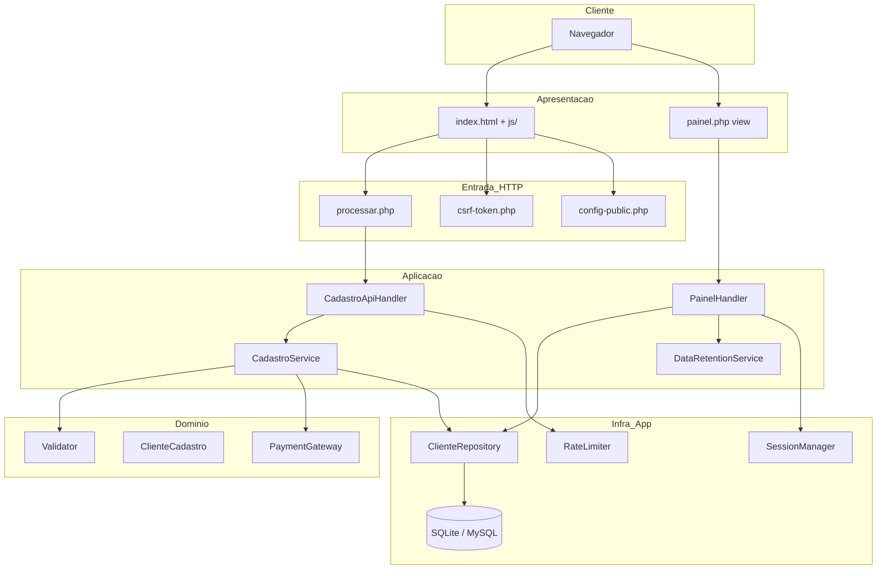
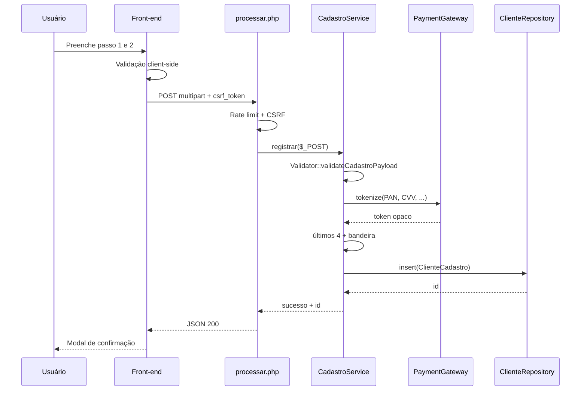
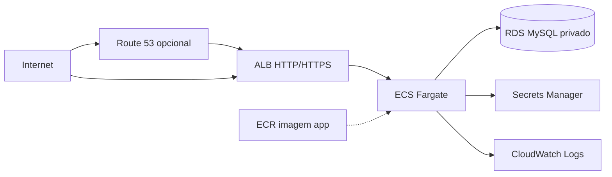

# Documentação completa da solução — CDT Jacarepaguá

**Sistema:** Cadastro Financeiro para filiação digital (Cartão de TODOS — unidade Jacarepaguá)  
**Versão do documento:** 1.1  
**Data de referência:** 22/novembro/2026  
**Stack principal:** PHP 8.2+, JavaScript (ES modules), Tailwind CSS, MySQL/SQLite, Docker, Terraform (AWS)

---

## 1. Visão geral

O CDT Jacarepaguá oferece um **formulário web em duas etapas** para coleta de dados pessoais, endereço e forma de pagamento (débito/crédito). Os dados são validados no cliente e no servidor, o cartão é **tokenizado** via gateway (mock ou Stripe) e apenas metadados seguros do cartão são persistidos. Um **painel administrativo** permite listagem paginada, exportação CSV, exclusão sob demanda (LGPD) e purga por retenção configurável.

### 1.1 Objetivos de negócio

- Digitalizar o cadastro financeiro da filiação com experiência mobile-first.
- Reduzir exposição de dados sensíveis de cartão (PCI DSS — princípio de não armazenar PAN/CVV).
- Permitir operação local (desenvolvimento), homologação e produção na AWS.
- Garantir rastreabilidade por meio de testes automatizados e pipeline de CI/CD.

### 1.2 Público deste documento

| Público | Uso |
|---------|-----|
| Arquitetos / tech leads | Decisões de deploy, segurança e evolução |
| Desenvolvedores | Onboarding, camadas e convenções |
| Operações / DevOps | Terraform, ECS, secrets, monitoramento |
| QA / auditoria | Critérios de aceite e estratégia de testes |

---

## 2. Contexto e escopo

### 2.1 Dentro do escopo

- Front-end estático (`index.html`, `js/`, `CSS/`).
- API de cadastro (`processar.php` → `CadastroApiHandler`).
- Painel admin (`painel.php` → `PainelHandler`).
- Persistência em `clientes_cartao` e `rate_limits`.
- Integração de pagamento abstraída (`PaymentGatewayInterface`).
- Infraestrutura como código (Terraform) para AWS completa.
- Perfil **AWS Academy**: EC2 + Docker + SQLite (`docker-compose.academy.yml`).
- CI (PHPUnit, Vitest, Playwright) e deploy ECS via GitHub Actions.

### 2.2 Fora do escopo (explícito)

- Processamento real de transações financeiras em produção (gateway mock por padrão).
- CRM, ERP ou integração com sistemas legados da operadora (apenas script de migração SQL legado).
- App mobile nativo.
- MFA / SSO corporativo no painel (somente senha com `password_hash`).

---

## 3. Arquitetura lógica

### 3.1 Camadas da aplicação



### 3.2 Fluxo de cadastro (happy path)



### 3.3 Módulos PHP (`src/`)

| Pacote | Responsabilidade |
|--------|------------------|
| `App\Http` | Handlers, CORS, JSON, sanitização de payload |
| `App\Service` | Orquestração de cadastro e retenção LGPD |
| `App\Repository` | PDO, schema, CRUD, paginação |
| `App\Payment` | Factory, mock, Stripe, sanitização PAN |
| `App\Security` | CSRF, sessão, rate limit, auth admin |
| `App\Validation` | Catálogo de erros para API |
| `App\View` | HTML do painel |
| `App\Database` | ConnectionFactory (sqlite/mysql) |
| `App\Support` | CpfMask e utilitários |

**Bootstrap:** `src/bootstrap.php` carrega Composer, `.env`, política de `display_errors` e sessão.

### 3.4 Front-end (`js/`)

| Arquivo | Função |
|---------|--------|
| `app-config.js` | CSRF + config pública (`APP_ENV`) |
| `validation.js` | CPF, Luhn, CEP, idade, validade |
| `form.logic.js` | Regras de negócio testáveis (Vitest) |
| `form.js` | Submit, integração com API |
| `modal.js` / `ui.js` | UX de feedback |
| `logo-switch.js` | Variantes de marca (oculto em `production`) |

CSS gerado com **Tailwind CLI** (`npm run build:css` → `CSS/app.css`).

### 3.5 Estrutura física do repositório

```
cdt/
├── Entradas HTTP na raiz: index.html, painel.php, processar.php,
│   csrf-token.php, config-public.php
├── src/              bootstrap.php, Config.php, camadas Handler/Service/Repository
├── js/ + CSS/        UI, validação e estilos compilados
├── sql/schema.sql    DDL MySQL (referência; SQLite via ensureSchema)
├── data/             SQLite local (gitignored quando aplicável)
├── tests/            PHPUnit, Vitest, Playwright
├── infra/terraform/  main.tf, vpc (inline), ecs.tf, rds.tf, alb, ecr, iam, dns, secrets
├── scripts/          Provisionamento AWS, Academy, lgpd-purge.php
├── docker/           vhost Apache, php.ini
├── Dockerfile + docker-compose.yml + docker-compose.academy.yml
└── docs/             RED, guias AWS, este documento
```

### 3.6 Contrato da API de cadastro (resumo)

**Endpoint:** `POST /processar.php`  
**Content-Type:** `multipart/form-data` ou `application/x-www-form-urlencoded`

| HTTP | Situação | Corpo (JSON) |
|------|----------|--------------|
| 200 | Cadastro aceito | `{ "sucesso": true, "id": <int>, "mensagem": "..." }` |
| 422 | Validação / negócio | `{ "sucesso": false, "mensagem": "...", "erros": [...] }` |
| 403 | CSRF inválido | `sucesso: false` + código em `erros` |
| 429 | Rate limit | Mensagem amigável + `rate_limit` no catálogo |
| 405 | Método não POST | `sucesso: false` |

Campos de cartão (`cartao`, `cvv`) são processados apenas em memória e no gateway; não aparecem no banco. Com `APP_DEBUG=false`, respostas não incluem o bloco `depuracao` (`PayloadSanitizer`).

---

## 4. Arquitetura física e ambientes

### 4.1 Ambiente local (desenvolvimento)

- Servidor embutido PHP ou XAMPP.
- Banco **SQLite** em `data/cdt.sqlite` (padrão `.env.example`).
- Opcional: `docker compose up` com MySQL.

### 4.2 AWS — produção / homolog (conta completa)



| Componente | Detalhe |
|------------|---------|
| **Rede** | VPC `10.20.0.0/16`, subnets públicas/privadas, NAT opcional (`cost_saver_mode`) |
| **Compute** | ECS Fargate, task Apache+PHP 8.2, health `/index.html` |
| **Dados** | RDS MySQL `db.t4g.micro`, credenciais em Secrets Manager |
| **Entrega** | ECR + `aws-publish.ps1` ou workflow `deploy-aws.yml` (OIDC) |
| **TLS** | ACM + listener 443 ou `certificate_arn` manual |
| **Homolog** | Workspace Terraform `homolog`, `project_name = cdt-hml`, cost saver |

Referências operacionais: [aws-publicacao.md](aws-publicacao.md), [aws-homolog-e-dominio.md](aws-homolog-e-dominio.md).

### 4.3 AWS Academy (Vocareum)

Conta restrita (sem ECS/RDS/IAM completo): **EC2 t3.micro** + **Docker** + **SQLite** via `scripts/academy-launch-ec2.ps1` e [aws-academy-ec2.md](aws-academy-ec2.md).

### 4.4 Container

`Dockerfile` multi-stage: build Tailwind (Node 22) → `php:8.2-apache` com `pdo_mysql`, `composer install --no-dev`, healthcheck local.

---

## 5. Modelo de dados

### 5.1 Tabela `clientes_cartao`

| Coluna | Tipo | Notas |
|--------|------|-------|
| `id` | INT PK | Auto incremento |
| Dados pessoais | VARCHAR/DATE | nome, email, telefone, CPF, nascimento |
| Endereço | VARCHAR | CEP, logradouro, número |
| Pagamento | ENUM + VARCHAR | tipo, últimos 4, bandeira, **token**, validade, titular |
| `criado_em` | TIMESTAMP | Retenção LGPD, ordenação |

**Não persistidos:** número completo do cartão, CVV.

### 5.2 Tabela `rate_limits`

Chave de bucket (hash), contagem de tentativas e início da janela — usada em cadastro e login do painel.

### 5.3 Compatibilidade SQLite

`ClienteRepository::ensureSchema()` adapta DDL (ENUM → TEXT no SQLite). Produção AWS usa schema MySQL em `sql/schema.sql`.

---

## 6. Segurança e conformidade

### 6.1 PCI (cartão)

- Tokenização antes da persistência; PAN/CVV só em trânsito na requisição POST.
- Armazenamento: `cartao_ultimos4`, `cartao_bandeira`, `pagamento_token`.
- Painel exibe PAN mascarado (`PaymentSanitizer::maskPan`).

### 6.2 LGPD

- Exclusão por ID no painel (com CSRF).
- `LGPD_RETENTION_DAYS`: purga automática (painel 1×/24h ou `scripts/lgpd-purge.php`).
- CPF mascarado no painel e no CSV (`CpfMask`).

### 6.3 Controles aplicados

| Controle | Implementação |
|----------|---------------|
| CSRF | `Csrf` + `csrf-token.php` |
| Rate limiting | `RateLimiter` + env `RATE_LIMIT_*` |
| Sessão admin | `SessionManager`, regeneração pós-login |
| Senha admin | `ADMIN_PASSWORD_HASH` (bcrypt via `password_hash`) |
| Erros em produção | `PayloadSanitizer`, `APP_DEBUG=false` |
| CORS | `Cors` + `CORS_ALLOWED_ORIGINS` |
| HTTPS cookies | `SESSION_SECURE=true` com TLS |

### 6.4 Segredos

- Local: arquivo `.env` (não versionado).
- AWS: Secrets Manager (`DB_PASSWORD`, `ADMIN_PASSWORD_HASH`, `STRIPE_SECRET_KEY`).

---

## 7. Integrações

| Integração | Modo | Configuração |
|------------|------|--------------|
| Gateway pagamento | Mock (padrão) | `PAYMENT_GATEWAY=mock` |
| Stripe | Opcional | `stripe` + `STRIPE_SECRET_KEY` + ext-curl |
| GitHub Actions | Deploy | Secrets `AWS_DEPLOY_ROLE_ARN` (+ homolog) |
| AWS | Provisionamento | Terraform em `infra/terraform/` |

---

## 8. Pontos de entrada HTTP

| Recurso | Método | Descrição |
|---------|--------|-----------|
| `/index.html` | GET | Formulário público |
| `/processar.php` | POST | API JSON cadastro |
| `/csrf-token.php` | GET | Token CSRF |
| `/config-public.php` | GET | Config não sensível |
| `/painel.php` | GET/POST | Login, listagem, delete, export |

---

## 9. Qualidade e testes

### 9.1 Pirâmide

| Camada | Ferramenta | Local |
|--------|------------|-------|
| Unitário PHP | PHPUnit 11 | `tests/Unit/` |
| Integração PHP | PHPUnit | `tests/Integration/` |
| Aceite | PHPUnit | `tests/Acceptance/AcceptanceCriteriaTest.php` |
| Unitário JS | Vitest | `tests/js/` |
| E2E | Playwright | `tests/e2e/` |

### 9.2 CI (`.github/workflows/ci.yml`)

- Push/PR na `main`: PHPUnit com meta **≥ 99,9%** cobertura em `src/`, Vitest, Playwright (Chromium).
- Windows local: `scripts/run-all-tests.ps1`; variável `PHP_BIN` se necessário.

### 9.3 Critérios de aceite (resumo CA-01 a CA-10)

Documentados em `AcceptanceCriteriaTest`: cadastro sem PAN/CVV, validação, CSRF, depuração off em produção, máscara CPF, paginação, auth admin, rate limit, gateway mock, exclusão LGPD.

---

## 10. Operação

### 10.1 Variáveis de ambiente (principais)

Ver `.env.example` e tabela no [README.md](../README.md).

### 10.2 Comandos úteis

```bash
# Desenvolvimento
composer install && npm install && npm run build:css
php -S 127.0.0.1:8080 -t .

# Testes
php vendor/bin/phpunit
npm run test:unit
npx playwright test

# AWS (conta completa)
.\scripts\aws-provision.ps1
.\scripts\aws-db-migrate.ps1
.\scripts\aws-publish.ps1
```

### 10.3 Scripts operacionais

| Script | Função |
|--------|--------|
| `scripts/aws-provision.ps1` | `terraform apply` (produção) |
| `scripts/aws-provision-homolog.ps1` | Workspace homolog + tfvars |
| `scripts/aws-db-migrate.ps1` | Schema / migração no RDS |
| `scripts/aws-publish.ps1` | Build Docker, push ECR, deploy ECS |
| `scripts/aws-setup-completo.ps1` | Orquestra setup inicial documentado |
| `scripts/academy-launch-ec2.ps1` | Lab Vocareum: S3, EC2, compose Academy |
| `scripts/lgpd-purge.php` | Purga por `LGPD_RETENTION_DAYS` (cron) |
| `scripts/run-all-tests.ps1` | PHPUnit + npm + Playwright (Windows) |

### 10.4 Observabilidade (AWS)

- Logs: CloudWatch `/ecs/<project_name>`, retenção 14 dias.
- Health: ALB → target group → `/index.html`.
- ECS: `aws ecs describe-services`, `aws logs tail`.

### 10.5 Backup e DR

- RDS: snapshots automáticos AWS (configurar política na conta).
- SQLite Academy/ local: volume Docker ou cópia de `data/cdt.sqlite`.
- Estado Terraform: recomendado backend S3 + DynamoDB lock (`versions.tf`).

---

## 11. Decisões arquiteturais (ADR resumido)

| ID | Decisão | Alternativa rejeitada | Motivo |
|----|---------|----------------------|--------|
| ADR-01 | Monólito PHP + Apache em container | Lambdas separadas | Simplicidade, custo, time de disciplina |
| ADR-02 | PDO sqlite/mysql dual | ORM pesado | Poucas tabelas, portabilidade Academy |
| ADR-03 | Gateway mock padrão | Sempre Stripe | Labs sem credenciais; PCI simulado |
| ADR-04 | Fargate + ALB | EC2 auto-scaling manual | Menos ops, alinhado ao pré-projeto AWS |
| ADR-05 | CSRF em form multipart | JWT stateless | Modelo tradicional PHP, menor complexidade |
| ADR-06 | Tailwind build no Docker | CDN Tailwind | Reprodutibilidade e CSP |

---

## 12. Evolução recomendada

1. Habilitar Stripe em produção com auditoria de escopo PCI SAQ A-EP.
2. Backend remoto para estado Terraform (S3).
3. WAF no ALB e IP allowlist no painel.
4. Métricas customizadas (cadastros/erros) no CloudWatch.
5. Fila assíncrona para notificações pós-cadastro (e-mail/SMS).

---

## 13. Referências internas

| Documento | Conteúdo |
|-----------|----------|
| [RED.md](RED.md) | Registro de Especificação de Desenvolvimento |
| [aws-publicacao.md](aws-publicacao.md) | Deploy produção |
| [aws-homolog-e-dominio.md](aws-homolog-e-dominio.md) | Homolog + HTTPS |
| [aws-academy-ec2.md](aws-academy-ec2.md) | Demonstração Vocareum |
| [README.md](../README.md) | Início rápido |

---

## 14. Glossário

| Termo | Significado |
|-------|-------------|
| CDT | Cartão de TODOS (unidade Jacarepaguá) |
| PAN | Primary Account Number (número do cartão) |
| PSP | Provedor de serviços de pagamento |
| ALB | Application Load Balancer |
| OIDC | OpenID Connect (login GitHub Actions na AWS) |

---

*Documento mantido pelo time de desenvolvimento do projeto acadêmico CDT Jacarepaguá. Atualizar versão ao alterar arquitetura ou requisitos significativos.*